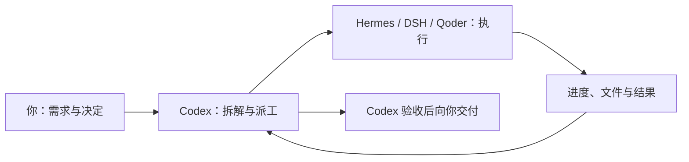

# Codex to Agents

**让 Codex 指挥 agents 干活。**

> **已经 clone 安装过？** 旧版需要先[手动升级一次](docs/upgrading.md)。升级后，打开 Agents 看板会每天最多自动检查一次更新，有新版时在「插件更新」提示；也可在这里开启默认关闭的「自动更新」。

在 Codex 里提需求，把具体工作交给 **Hermes**、**DeepSeek Harness（DSH）** 或 **Qoder CLI（Qoder）**，再回到同一个会话查看进度、继续追问、验收产物。

你控制派工开关和执行端，Codex 负责拆解与验收，Agent 负责实际执行。需要派工时，在 Codex 左侧的 **Agents 看板**打开开关；关闭后，继续按原来的方式使用 Codex。

> 「SOL 规划、DSH、Hermes 或 Qoder 实现代码」这种模式的实际效果**暂未验证**。

[界面预览](#界面预览) · [分工与选型](#分工与选型) · [安装与接入](#安装与接入) · [第一次派工](#第一次派工) · [日常使用](#日常使用) · [常见问题](#常见问题) · [支持范围](#支持范围) · [进阶手册](docs/advanced.md)

## 它帮你完成什么

当你已经在使用 Codex 和另一个 Agent 时，可以把需求下发、进度跟踪和结果回传接起来，减少在工具之间复制粘贴。

| 你要做的事 | 使用方式 |
|---|---|
| 把明确的编程任务交给 Agent | 在 Codex 说明目标、目录和验收条件，由它派发任务 |
| 随时决定是否派工 | 在看板切换「自动派工」，选择执行端、可用模型和思考强度 |
| 知道任务进度或接着修改 | 在 Codex 查询状态，或继续提要求并沿用原生 Agent 会话 |
| 检查交付是否可用 | Codex 读取结果，核对文件并运行相应验证 |



## 界面预览

**在 Codex 看板控制派工。** 选择执行端、模型与思考强度，独立开关 SDD 任务文档，并查看插件更新。


**在 DSH 保留原生执行会话。** 查看执行结果、模型与权限设置，也可以回到 Codex 继续跟进和验收。


*执行会话截图已做隐私遮挡；截图中的用量来自单次任务，不代表通用性能或成本结论。*

## 分工与选型

SOL 在 Codex 中做关键决策，执行 Agent 负责高频交付：

- **明确边界**：把需求转成目标、允许修改的范围和必须保留的行为。
- **降低执行难度**：给出实现步骤、异常场景和验收条件。
- **协调修改**：先确定接口、数据约定和修改顺序。
- **检查交付**：核对文件和运行结果，再安排必要修复。

执行端选型看三点：**快**（完整交付时间）、**量大管饱**（成本、额度与吞吐）、**能力达标**（按明确方案修改多个文件并自行验证）。DSH、Hermes 与 Qoder 提供执行框架，实际速度、额度和代码能力取决于接入的模型与提供方。

这套分工的目标是 **SOL 做少量关键决策，执行 Agent 高频交付合格代码**。

## 安装与接入

### 1. 准备环境

本教程面向 macOS 本机桌面工作流。开始前需要：

- **Node.js 22.19+** 和 npm。
- **Codex 桌面端及 CLI**；桌面端需支持插件、MCP Apps 看板和插件 Hook。
- **Hermes Agent CN Desktop、DSH 桌面端或 Qoder CLI**，至少选一个；桌面端需已配置模型并能在原生界面正常聊天，Qoder CLI 需已安装并登录。

模型账号和用量由执行端管理。首次使用自动派工，需要在 Codex 审核并信任插件 Hook；派工开关默认关闭。

```bash
git clone https://github.com/heystarlink/codex-to-agents.git
cd codex-to-agents
npm ci
mkdir -p "$HOME/codex-agents-demo"
```

下面三条接入路线任选，也可以分别启用多个执行端。安装完成后请保留仓库目录和 Node 可执行文件，插件运行时会用到它们。

### 2. 连接执行端

**使用 Hermes**

先打开 Hermes，确认可以正常聊天，再在本仓库目录运行：

```bash
node src/command.mjs enable --executor hermes \
  --directory "$HOME/codex-agents-demo"
```

默认连接本机 `http://127.0.0.1:9120`，使用 Hermes 当前默认模型。其他端口和模型限制见[进阶配置](docs/advanced.md#配置执行端)。

**使用 DSH**

先打开 DSH。下面允许派工使用 DSH 中已加载的全部模型提供方，模型目录会随 DSH 配置更新：

```bash
node src/command.mjs enable --provider '*' \
  --directory "$HOME/codex-agents-demo"
```

命令会为 DSH 安装本地执行插件。若插件没有自动加载，重启 DSH。需要限定派工使用的提供方时，将 `'*'` 换成实际 ID，例如 `deepseek-account`；多个 ID 用逗号分隔。看板仅显示允许范围内的模型。

**使用 Qoder CLI**

先安装官方 Qoder CLI 并完成登录。安装、登录和账号都由官方 CLI 管理；本项目不安装软件、不读取凭据：

```bash
curl -fsSL https://qoder.com/install | bash
qodercli login
qodercli --list-models   # 确认可列出可用模型
```

再在本仓库运行：

```bash
node src/command.mjs enable --executor qoder \
  --directory "$HOME/codex-agents-demo"
```

若未自动找到 Qoder CLI，可加 `--qoder-executable /绝对路径/qodercli`。`--directory` 是默认任务目录，必须是绝对路径。Qoder 看板的模型来自真实 `qodercli --list-models` 输出；未安装、未登录或输出无法识别时，看板会显示具体原因。后续可用 `disable --executor qoder` 关闭并保留历史工作单。

三条路线都会备份配置并注册派工连接；已有其他执行端的配置会保留。`enable` 和 `plugin-install` 都支持 `--codex`，找不到 Codex 命令时用它指定 CLI 路径。

新安装默认使用 **stdio 连接**：Codex 启动本机 Node 桥接，桥接再用本机私有凭据连接共享后台。也可以显式选择 HTTP 直连：

```bash
node src/command.mjs enable --executor hermes \
  --directory "$HOME/codex-agents-demo" \
  --transport http
```

`--transport stdio|http` 可用于 `enable` 和 `plugin-install`。显式选择会保存在所选数据目录，之后的重装、看板安装和插件更新都会沿用；没有保存过选择时使用 stdio。非法或损坏的保存值会明确报错，不会静默切换。`enable` 只注册派工连接，不会刷新已安装的看板；要让看板也使用同一传输，请再运行一次 `plugin-install`（命令输出也会提示）。

HTTP 直连仍连接本机回环地址，不改变宿主代理设置。如果 Codex 所在环境使用 `ALL_PROXY`/`HTTP_PROXY` 等代理但没有放行 `127.0.0.1`/`localhost`，请使用默认 stdio，或自行在宿主环境中放行回环地址；本工程不会修改你的全局代理变量。连接失败时不会自动换成另一种传输并重放任务，请先核对原工作单再处理。

### 3. 安装 Agents 看板

```bash
node src/command.mjs plugin-install
```

如需 HTTP 直连，可在首次安装时写一次 `--transport http`；之后无需重复。安装命令会按保存的连接方式同时生成派工和看板连接。

安装后：

1. 重启 Codex，让客户端载入插件和连接配置。
2. 按 Codex 的提示审核并信任 **Agents 看板**的 `UserPromptSubmit` Hook，然后新建会话。
3. 从左侧打开 **Agents 看板**，选择刚接入的 **Hermes**、**DSH** 或 **Qoder**，再选择模型或跟随执行端默认；选择固定模型后可按执行端提供的选项设置思考强度。
4. 打开 **自动派工**。设置保存后，从下一条消息生效。

看板集中设置派工开关、执行端、可用模型、思考强度和当前执行端的新会话权限；首次信任 Hook 后，日常切换无需重启，也无需每次重复说“调用 Agent”。具体是否派工仍由 Codex 结合任务和当前指令判断。

三个执行端各自保存自己的「新会话权限」，切换执行端不会丢失其他端的选择。权限只对之后新建的派工会话应用，已有会话和追问不重新读取看板；执行端未提供所选权限时，保存和派工都会明确失败，不会静默换成其他权限。

**开启后显示「待生效」时，先处理卡片中的 Hook 提示。** 在 Codex CLI 输入 `/hooks`，审核并信任 Agents 看板的 `UserPromptSubmit` Hook。看板会读取 Codex 的真实信任状态；首次安装或更改 Hook 后，旧会话需重新加载，已开始的任务不会中途自动转交。

## 第一次派工

先用一个可以直接核对结果的小任务走通流程。在已开启自动派工的 Codex 新会话中发送：

```text
在接入时配置的默认任务目录中创建 hello.js，运行后输出 Hello, World!。
只修改 hello.js。请交给所选 Agent 实现，完成后检查文件并实际运行验证，告诉我结果。
```

Codex 会检查执行端、限定范围并保存工作单；Agent 在 Hermes、DSH 或 Qoder 中创建原生会话执行；最后 Codex 核对文件和运行结果并向你报告。完成后也可以自己验证：

```bash
node "$HOME/codex-agents-demo/hello.js"
```

运行后应输出 `Hello, World!`。**「已提交」表示任务已保存；实际成功要看文件、执行输出和验收结果。** 如果任务持续执行中或失败，按[任务没有完成时怎么查](#任务没有完成时怎么查)检查。

## 日常使用

### 自己决定什么时候派工

| 开关状态 | 后续行为 |
|---|---|
| 开启 | Codex 按所选执行端的派工偏好处理编程、修复和测试任务；问答与规划直接处理 |
| 关闭 | Codex 停止主动派发新任务，已提交的工作继续跟进 |
| 关闭，但你明确指定 Agent | 仍可以按你的明确要求调用该 Agent |

开关、执行端、模型和思考强度对**共用同一数据目录的 Codex 会话**生效。当前没有每个会话单独保存的开关。新任务使用所选模型和强度，已有任务和追问沿用原会话配置；切换执行端后模型恢复为跟随该执行端默认，不会迁移已经提交的任务。

「新会话权限」按执行端分别保存，只在之后新建派工会话时应用一次；已有会话和追问不会被重新设置。跟随默认时不写入任何权限设置。各执行端的权限作用不同，请按看板说明选择；任务目录本身不提供文件隔离。

可用模型读取自执行端配置，并显示提供方。Qoder 的模型目录来自真实 `qodercli --list-models`；执行端离线、未登录或目录读取失败时会在看板上提示，不会凭猜测列出模型。思考强度只展示执行端目录为该模型提供的选项；目录没有强度选项时不虚构选项。

### 查看、补充或停止任务

| 目的 | 示例消息 |
|---|---|
| 查进度 | 「查看刚才任务的状态，告诉我当前进度和是否需要我处理。」 |
| 补充要求 | 「继续刚才的任务，补一个边界条件测试，再运行相关测试。」 |
| 请求停止 | 「请求取消刚才的任务，并确认执行端是否已经停止。」 |

关闭自动派工、关闭看板或关闭 Codex 会话，都不会向执行端发送取消指令。Qoder 的取消只针对本适配器创建的那个 CLI 子进程，不会影响你在终端里自己运行的 `qodercli`。需要停止工作时，明确请求取消并检查结果。

### 检查并安装插件更新

看板底部的折叠「插件更新」区可以检查并安装 GitHub 默认分支上的更新。默认关闭 **自动更新**，有新版时手动安装；开启后，看板每天首次打开时检查，发现新版便尝试自动安装。展开区域和 **刷新状态** 只读取本地缓存，手动 **检查更新** 可立即访问远端。

只有安装目录干净、当前分支可快进且没有正在运行的任务时才会执行更新，不会 stash、reset、强推或删除未跟踪的 SDD 文档。有本地改动、分叉、离线或忙碌时会阻止并说明原因。更新完成后需要重新加载 Codex，或重启 DSH，才能使用新版本；本工程不会自动重启这些应用。

### 匿名发送使用统计

Agents 看板中的「发送匿名使用统计」在未保存过选择时默认开启；你随时可以关闭，关闭后停止后续上报。开启后，共享后台仅在使用插件时，向 `https://stats.helloping.ccwu.cc/v1/usage` 发送随机安装 ID 和插件版本；服务端记录 UTC 日期，用来估算已激活安装数与周活跃安装数。

不上传代码、提示词、项目路径、任务内容或账号。随机 ID 只保存在本机数据目录，更新插件时保留；多个会话共享它。每个 UTC 日最多尝试一次，网络超时不会阻塞派工。开关独立于自动派工和 SDD，模型无法替你修改。

Cloudflare 作为网络服务提供方仍会处理连接信息。服务端不记录请求正文、IP 或账号，统计数据没有公开读取接口；关闭开关不会撤回已发送的数据。这些指标是参与统计的安装数估计，不等同于真实人数。[服务端与查询说明](services/usage-stats/README.md)。

### 多个会话一起使用

同一数据目录下，派工连接和看板共用一个 **`agents-backend`** 后台。打开多个会话不会各自再启动一套执行后台；看板隐藏时暂停界面查询，恢复显示后立即更新，任务继续在后台执行。Hermes 与 Qoder 执行模块按需加载，没有对应配置时不加载；空闲的 Qoder 不常驻 CLI 子进程。

使用默认 stdio 连接时，每个 Codex MCP 连接会多一个轻量的 Node 桥接进程，消息仍转到同一个共享后台，不会为每个会话新建执行消费者。桥接本身也有进程与内存开销，因此 stdio 只是更容易绕过宿主代理，并不承诺比 HTTP 更省内存。HTTP 模式不增加桥接进程，但需要宿主代理放行回环地址。

工作单在后台共享，已完成历史只在文件变化时更新，新任务仍会立即处理。实际占用随模块加载和任务数量变化，可用 `backend status` 查看 PID。

### 轻量 SDD 共享工作区

项目下每个任务各留一份 `task.md`，写清**目标、范围、计划和验收条件**。开启自动派工后，Hook 会要求 SOL 在明确开发任务的方案形成后，先通过 `sdd_task` 保存任务约定，再把保存返回的文档路径交给执行 Agent。普通问答和讨论不创建任务文档。

SDD 任务文档有独立开关，位于看板设置区、始终可见，默认开启。关闭后 Hook 不再要求文档和路径交接，`sdd_task` 拒绝创建、登记和保存，自动派工仍可正常使用；已有文件、目录设置和自动派工开关都会保留。

在左侧 Agents 看板展开 SDD 文档区：设置共享工作区目录（默认 `~/.codex-to-agents/sdd`），按名称创建项目分类，再在项目下新建或编辑 `task.md`。查看 SOL 保存的任务约定，或复制文档路径，在 Codex、DSH、Hermes 或 Qoder 中引用。

SDD 文档目录只存放任务约定，不是代码目录；派工时的工作目录仍指向实际代码项目。切换文档目录后查看新目录中的文档，原目录文件保留。

## 常见问题

### 看板已安装，但没有入口或没有自动派工

先查看卡片中的 Hook 状态。若显示「待生效」，按提示在 Codex CLI 的 `/hooks` 审核并信任或启用该 Hook。Hook 已信任后，重新加载旧会话；仍未加载插件时，重启 Codex 或新建会话。确认开关已开启，执行端也选对了。

### 开启代理后看板连接失败

如果使用 HTTP 连接时看板提示连接失败，先确认 Codex 所在环境可以直连 `127.0.0.1`。宿主代理没有排除回环地址时，本机请求可能被送往代理并失败。可以改用默认 stdio：

```bash
node src/command.mjs plugin-install --transport stdio
```

也可以在宿主环境中把 `127.0.0.1` 和 `localhost` 加入 `NO_PROXY`。本工程不会修改 `ALL_PROXY`、`HTTP_PROXY`、`HTTPS_PROXY` 或 `NO_PROXY`。连接失败后，不要盲目切换传输重放同一任务；先用原工作单编号核对状态。

### 执行端显示离线怎么办

先确认对应执行端可用：Hermes 在原生界面可以正常聊天；DSH 已打开并加载插件；Qoder 在终端执行 `qodercli --version` 与 `qodercli --list-models` 正常（未登录会明确提示）。也可以让 Codex 检查连接而不提交任务。

如果仍离线，运行 `node src/command.mjs backend status` 和 `node src/command.mjs status`。后台在线与执行端在线是两件事：DSH 需要已加载执行插件，Hermes 需要其本机 Dashboard 可连接，Qoder 需要已配置可执行文件且 `--list-models` 可读。

### 任务没有完成时怎么查

先在 Codex 中查看原任务，再打开对应原生聊天，确认是否等待权限、用户输入或模型响应。模型调用超时也可能表现为长时间执行中。

工作单已保存并不代表执行端已经成功完成。若状态为 `uncertain`（待核查），先检查原生记录和实际文件；使用原工作单编号查询，避免重新派发同一份变更。

### Qoder 的会话在哪里

Qoder 的任务通过 CLI 执行，会话不会自动同步到 Qoder 桌面侧栏。在 Codex 中查询原任务的结果或继续追问即可；需要停止时明确请求取消并核对结果。

## 支持范围

当前支持 **DSH 桌面端**、**Hermes Agent CN Desktop** 和 **Qoder CLI**，通过本机工作单保存任务、进度和结果。支持目录、模型选择与同会话追问。DSH 还提供桌面项目注册和聊天列表/改名/归档/恢复；Hermes 提供会话管理；Qoder 使用任务目录与原生会话续聊，没有经过验证的会话列表/改名/归档/恢复能力，这些操作会明确拒绝，也不支持运行中转向。

本工程使用执行端已有的模型配置，不读取模型 API 密钥或账号凭据。文件修改和工具执行仍受执行端权限约束，任务目录提示不能替代权限控制。当前不自动选择最优模型、提交或合并代码，也不提供远程多机调度。

## 继续阅读

- [进阶手册](docs/advanced.md)：配置参数、工作单与 MCP 工具、升级、停用和开发验证。
- [设计说明](DESIGN.md)：共享后台、持久化、恢复策略和接口依据。
- [已有 Hermes Hello World 示例](examples/hermes-hello-world/hello.py)：Python 文件示例。
